# LittleBricks: live browser playtest

Date: **2026-11-11**. Reviewer: ChatGPT using the user-authorized Browser connection, operating the actual LittleBricks tab at `http://localhost:8080/`.

## Scope and evidence boundary

This report records actual on-screen interactions, not direct calls to game methods. The desktop capture size was **1470 × 745**. A temporary **390 × 844** viewport checked narrow-layout behavior; it did not emulate physical touch, a phone GPU, or haptics. The viewport was restored afterward. The initial connection attempts timed out; a subsequent connection succeeded and the review below was performed.

The related source review examined **`81c7a6593e9b25c6c9bc14ff0597276d4bcae0df`**. The running export did not expose a source revision in the inspected UI, so its exact binary-to-source correspondence is **unverified**. Its screens and observed behavior are consistent with that source. The next build must expose a small About/build-information view and record export checksums so this ambiguity disappears.

**Audio was not heard through this connection.** Its available browser controls supplied screenshots, pointer/keyboard actions and console messages, but no audio-listening capability. Musical taste, click quality, actual looping, and speaker output are therefore **NOT RUN** here. Audio asset/code findings below are separately identified. No child/parent participants were recruited; this is an expert interaction and presentation review, not invented family-user research.

The user-provided screenshots from the earlier implementation were not used as current-build evidence. These new captures show only the game viewport, without unrelated tabs or account content. [Screenshot manifest and SHA-256 values](images/2026-11-11-live/manifest.json).

## Verdict

**The browser build loads and exposes several real controls, but the central mouse-building interaction fails. The current release-complete claim is not acceptable.** The visual presentation also falls substantially short of the inviting family tabletop experience described in the design documents.

Useful progress is visible: Welcome/Mode/Setup navigation, multiple hands, a searchable catalogue, on-screen manual height and placement, camera orbit/zoom, an exploration scene, POV switching, and a saved Continue entry. Those pieces need correct integration and substantial presentation work.

## Observed results

| ID | Action and observation | Result / significance |
| --- | --- | --- |
| LIVE-01 | Moved the pointer to separated empty board areas and clicked. Both the existing session and a newly created Solo Free Build session retained `Stud: (16,16)` and the center preview. | **FAIL:** the mouse cannot choose a placement location. |
| LIVE-02 | In the fresh session, clicked the visible Place button. The first brick appeared at the center. Moving to the far side of the board afterward still left the preview at `(16,16)` and produced COLLISION against that brick. | **FAIL:** successful button placement does not establish usable mouse building. |
| LIVE-03 | Enabled Camera Mode, dragged across the board, then scrolled over the world. The camera visibly orbited and zoomed. | **PASS, narrow scope:** these particular desktop camera actions work. Pan, touch and every camera/placement conflict were not established. Do not report that all camera movement is broken. |
| LIVE-04 | Opened All Parts and scrolled its list. The list scrolled **and the board visibly zoomed out behind it**. | **FAIL:** modal UI does not own its input exclusively. |
| LIVE-05 | Selected Brick 1x4, raised Manual Height three times, and pressed Place. A narrow brick stacked on the first brick. | **PASS, narrow scope:** a manual-height stack can be made. This does not pass the independent lattice fixtures, automatic surface targeting, or a house-building journey. |
| LIVE-06 | Entered Explore, toggled first-person view, then returned to the table. Navigation and POV toggle worked; the upper brick changed from its blue/purple appearance to red on return. | **FAIL:** rendering/session color preservation needs repair. Source independently shows selected color is omitted from session submission. |
| LIVE-07 | Pressed My Builds on Welcome. The result was Choose How to Build, not a saved-build library. | **FAIL:** the visible action has the wrong destination. |
| LIVE-08 | Started untimed two-player Pass & Play. P1's hand was Brick 1x10, Cone 1x1, Roof Ridge 1x2, Plate 1x6, Tile 1x3, Brick 1x2. Opened All Parts, selected **Brick 1x1**, and pressed Place. The brick was accepted and the header advanced to P2. | **FAIL:** an unavailable part can bypass the mixed-hand rule. |
| LIVE-09 | Chose Play Online → Create Private Room. It opened a one-player tabletop directly, without a visible room code, invitation, waiting roster or ready lobby. | **FAIL of the promised route:** source confirms the route constructs a local session instead of connecting NetworkClient. No two-client networking test was performed here. |
| LIVE-10 | Inspected Welcome, mode cards, setup, building, catalogue and settings. Screens use plain dark panels; several icons display missing-glyph boxes. Long diagnostic text pushes the building header and actions beyond the viewport. The catalogue's fourth column is clipped and has no part thumbnails. | **FAIL of the agreed presentation:** visual choice, hierarchy and readability are missing. |
| LIVE-11 | Set the viewport to 390 × 844. Welcome and the building toolbar became tiny versions of the desktop controls, surrounded by large empty areas or world rendering. | **FAIL:** responsive layout is not achieved by shrinking controls. This is viewport evidence, not a physical-device test. |
| LIVE-12 | Clicked Welcome's Sound toggle; its label changed to Muted. Reloaded; it returned to Sound, and Settings showed Enable Audio checked. | **FAIL:** the Welcome mute preference was not retained in this sequence. No inference about audible output is made. |
| LIVE-13 | Explore immediately showed a large primitive toy figure and a generic scene, without a creation reveal. First-person initially faced sky/table, away from the creation. No Watch Build or film/export action was visible in the inspected journey. | **FAIL of the reward/film flow:** the player is not guided to enjoy, explore or share the thing they built. Walking through a real interior remains untested. |
| LIVE-14 | Save & Leave from the test creation produced a Continue entry named REVIEW that survived page reload. | **PASS, narrow scope:** a Continue entry persists. Full-state restoration, gallery behavior and save failure recovery remain separate gates. |

The captured warning/error log query returned an empty list. The interaction failures above occurred nevertheless. Zero console messages cannot substitute for playable controls.

## Reproduction detail

### Frozen pointer through the real entry scene

1. Start at Welcome, choose New Creation → Build Solo → Free Build (Full Catalogue).
2. Create the test creation `REVIEW` and press Start Building.
3. At 1470 × 745, move/click an uncovered board point around `(330,430)`. The preview stays at `(16,16)` rather than following the mouse.
4. Click the right-side Place button around `(1378,368)`. The brick is committed at the center.
5. Move to a distant board point around `(1090,473)`. The target remains `(16,16)` and the HUD reports collision with the center brick.

The coordinates describe this viewport only; future automation must identify the rendered board for its actual canvas size. The suspected full-window `AppRoot/ViewContainer` interception is documented in the [source review](2026-11-11-current-app-source-review.md). The symptom is reproduced; its final causal fix must still be verified in a rebuilt export.

| Before the Place-button commit | After the commit and moving elsewhere |
| --- | --- |
|  | 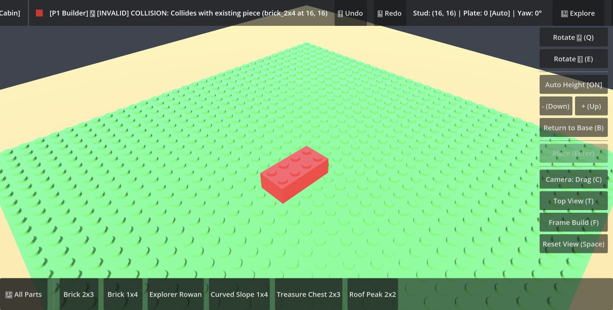 |

### Catalogue scroll leaks into camera zoom

Open All Parts from the table, then scroll down with the pointer inside the catalogue list. The underlying board becomes smaller while list contents advance. This is a real input-routing failure, not simply a preference for different camera speed.

| Catalogue before wheel scrolling | Catalogue after wheel scrolling |
| --- | --- |
| 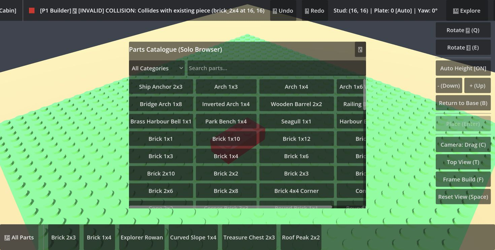 | 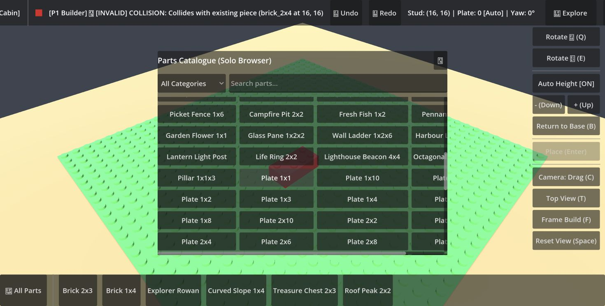 |

### Part/color roundtrip and exploration

Manual height made a second brick possible despite the frozen pointer: select Brick 1x4, press Up three times, then Place. Enter Explore, toggle POV, then Return to Table. The top brick changes appearance to red. Investigate accepted color/state, not an arbitrary lighting adjustment.

| Before Explore | After Return to Table |
| --- | --- |
| 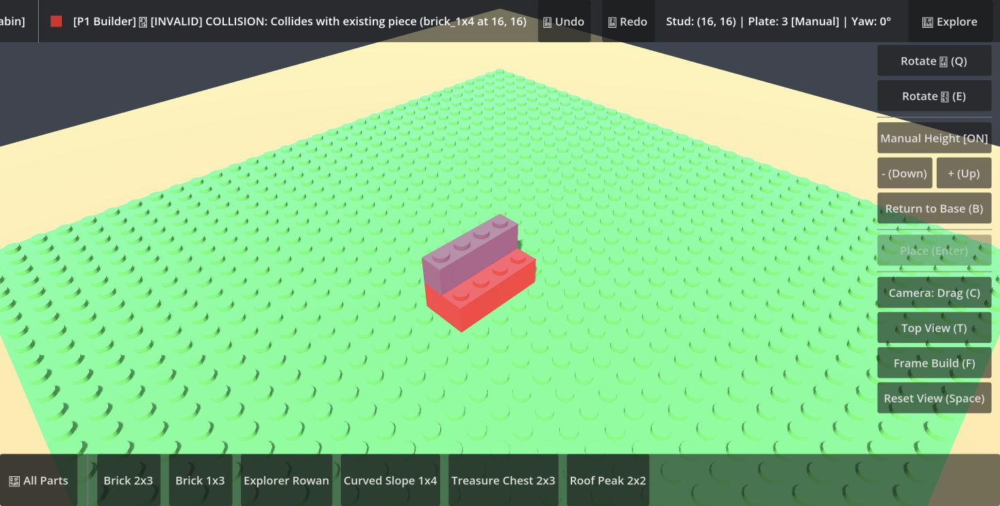 |  |

The initial exploration cameras do not present the creation:

| Third-person arrival | First-person arrival |
| --- | --- |
| 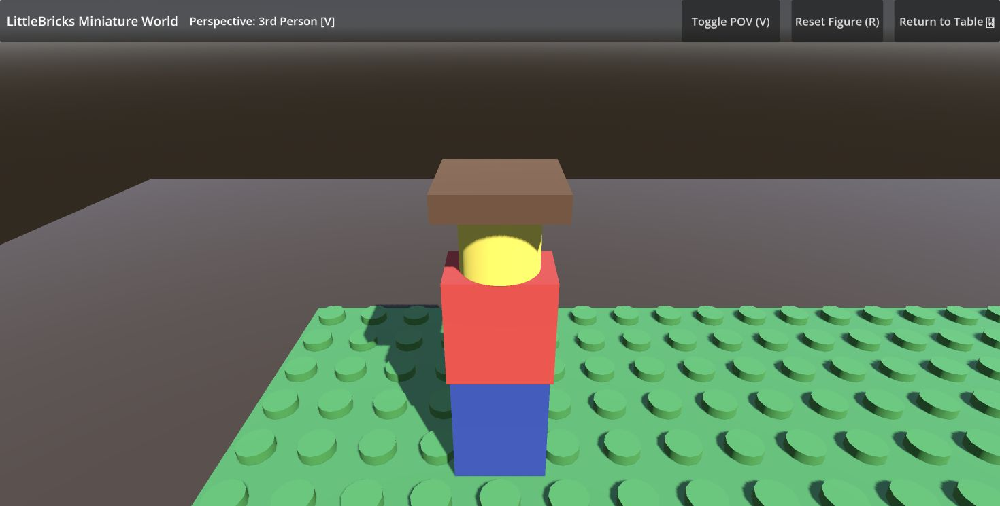 | 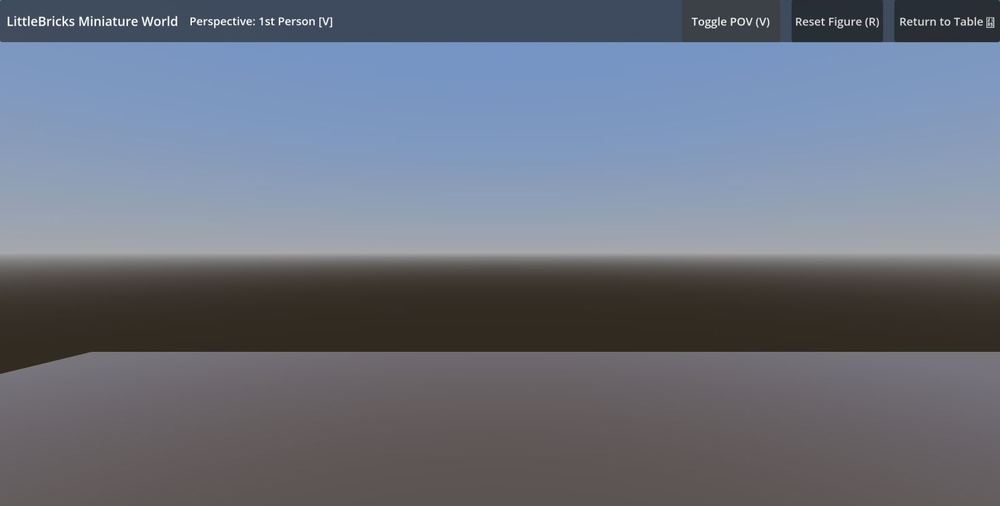 |

### Mixed-hand bypass

Start two-player Pass & Play with the timer disabled. Record the active six-part hand. Open All Parts and select a part not in that hand; in this run, Brick 1x1. The visible Place button accepts it and advances the turn. Use this exact negative test after connecting the table to the validated session command path.

| Outside-hand part selected; original hand visible | Accepted part and next player |
| --- | --- |
| 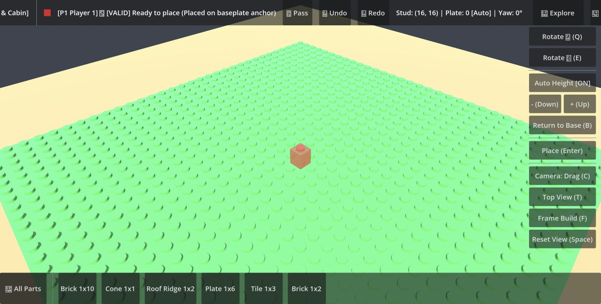 | 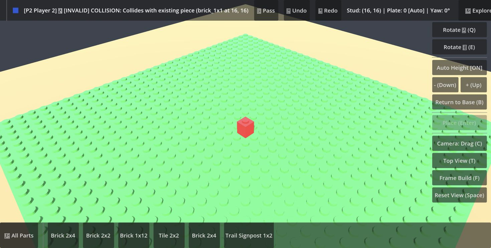 |

## Presentation assessment

The difficulty is more substantial than a missing coat of polish. The first screen offers text and administrative buttons without showing the appealing thing a family will make. Mode choices lack recognizable illustrations. Setup feels like a form. Building presents a permanent technical error/status bar, a list of part names and many competing controls. A successful placement immediately leaves a collision message against the new brick. There is little distinction between a helpful toy-like preview and a developer diagnostic.

The new [family experience brief](../FAMILY_PLAY_EXPERIENCE.md) specifies a bright craft table, original visual identity, picture-led choices, a readable hand of brick thumbnails, clear interaction states, satisfying accepted-placement feedback, and a finished creation that is framed and celebrated. It also requires genuine specialty-part geometry; increasing catalogue labels alone does not improve the experience.

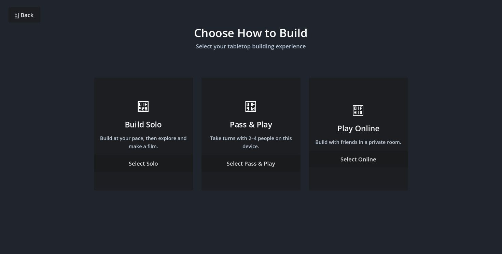

At the phone-sized viewport, the control scale itself is the defect:

| Welcome at 390 × 844 | Building at 390 × 844 |
| --- | --- |
| 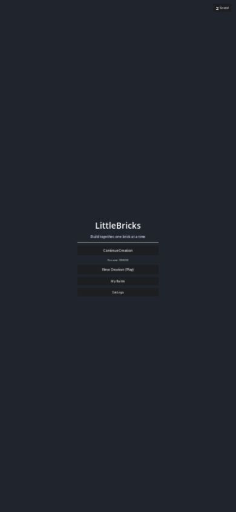 | 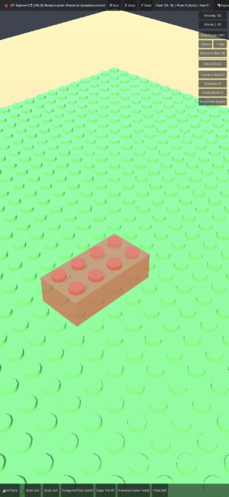 |

## Audio: source findings, not a listening review

Inspection of the source checkout found two **16.0-second, mono, 44.1 kHz** music WAVs and two **10.0-second** ambience WAVs. Their RIFF chunks are `fmt ` and `data`, without embedded loop metadata. Their imports use `edit/loop_mode=0` (Detect From WAV), and `audio_director.gd` does not configure looping or restart on finish. A same-track early return can also prevent replay after a cue ends. These facts predict stopped playback and require an audible runtime check; they do not establish what was heard on the user's speakers.

Additional source issues: no call site for the custom `unlock_audio()` helper; startup hardcodes channel volumes instead of applying the saved values; master/channel gain is applied in both players and buses; the UI bus is not used by the pooled effects. Whether Godot's own web audio activation already resumes output must be tested on the pinned engine/export, not assumed from the unused helper alone.

The Welcome mute-label reset was observed directly:

| Before reload | After reload |
| --- | --- |
| 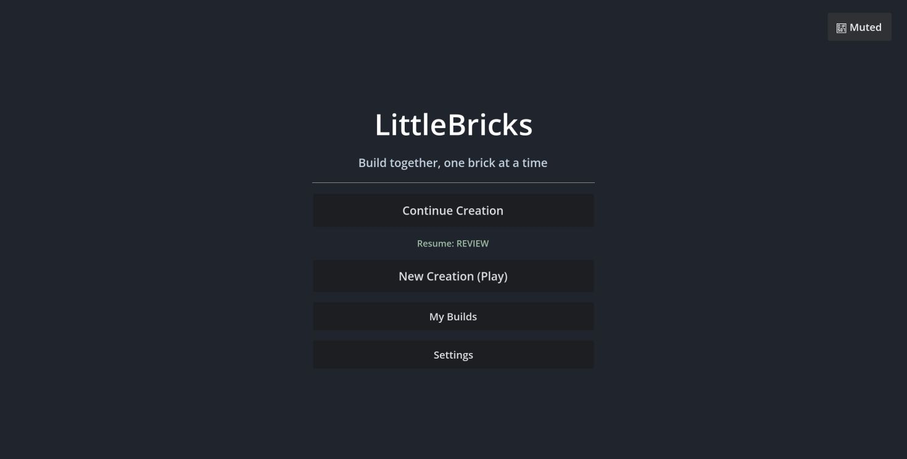 | 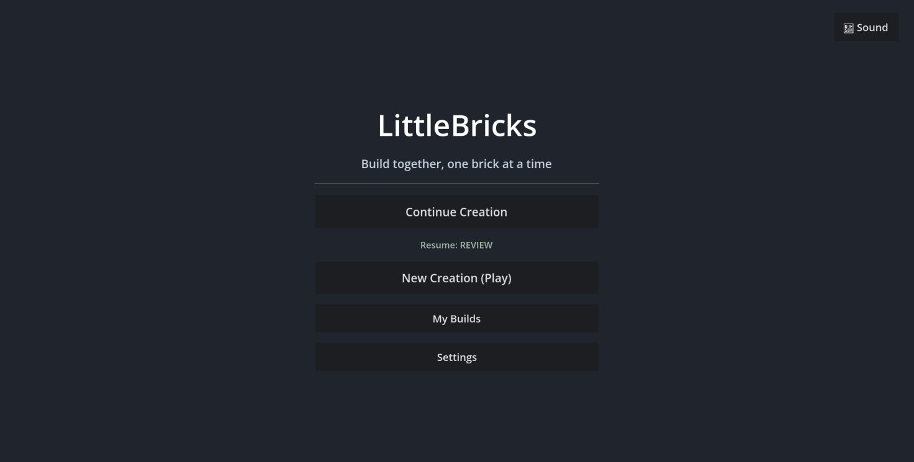 |

Relevant primary references: [Godot Control input filtering](https://docs.godotengine.org/en/4.6/classes/class_control.html#enum-control-mousefilter), [WAV importer loop modes](https://docs.godotengine.org/en/4.4/classes/class_resourceimporterwav.html#class-resourceimporterwav-property-edit-loop-mode), and [AudioStreamWAV looping](https://docs.godotengine.org/en/stable/classes/class_audiostreamwav.html#class-audiostreamwav-property-loop-mode). Use documentation matching the selected engine for implementation; importer enum values and runtime-stream enum values are different.

## What remains unverified

- Audible music/SFX quality, actual browser audio output and loop continuity; physical haptics.
- Precise connector/lattice fixtures at all rotations, automatic stack-to-base targeting after the pointer repair, and complete house/interior construction.
- Actual walking through an interior, camera pan, trackpad-specific gestures and physical touchscreen controls.
- Two-to-four real network clients, server restart recovery, and actual film creation/download/playback.
- Sustained performance, Android builds/devices, iPhone Safari and store release readiness.

The existing user session was saved through its visible Save & Leave control before new-session testing. `REVIEW` is the test creation saved during this review. Unsaved Pass & Play/Online test sessions were discarded by page reload. The browser was left at Welcome with its normal viewport restored; no application source was changed during the playtest.

## Next action

Execute [PLAYTEST_REPAIR_PLAN](../PLAYTEST_REPAIR_PLAN.md), beginning with the real exported application and input ownership. The outcome required is a game that can be played from its actual screens, then an experience worth returning to. This report and its screenshots do not close any repair task.
